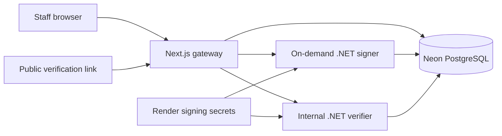

# NGO Certificate Operations & Verification Platform

Create events, upload certificate designs, issue signed PDFs, and publish certificate verification links. Staff manage records through a private Next.js console; recipients and employers use the public verification page without signing in.

## Architecture



Neon stores the event and participant records, audit ledger, uploaded templates, template layouts, signed PDFs, and detached signatures. Render's local data directory is disposable working space. Redeployments do not depend on a bundled SQLite database or certificate files.

The signing certificate and public root certificate are supplied through Render secrets. The root CA private key stays offline. The verification service checks the PDF hash, detached CMS signature, and certificate trust chain.

## Deploy to Render with Neon

Follow [the deployment plan](docs/deployment-plan.md) to create the Neon database, provision signing material, configure Render, and run the release smoke tests.

The [Render Blueprint](render.yaml) defines one Docker web service. Next.js listens on Render's public port; the verification service listens on loopback. The signer runs on demand. A persistent Render disk is not required because runtime records and files live in PostgreSQL. Select a Render plan based on measured issuance workload; no fixed memory or throughput claim is made.

Required secret settings:

| Setting | Purpose |
| --- | --- |
| `DATABASE_URL` | Neon pooled PostgreSQL URI with TLS |
| `ADMIN_EMAIL` | Staff login email |
| `ADMIN_PASSWORD` | Staff password, at least 12 characters |
| `SESSION_SECRET` | Random secret of at least 32 characters; generated by the Blueprint |
| `Platform__InternalApiKey` | Internal API key of at least 32 characters; generated by the Blueprint |
| `Signing__PfxPassword` | Password for the signing PFX |
| `SIGNING_PFX_BASE64` | Base64 encoding of the signing PFX |
| `TRUSTED_ROOT_PEM_BASE64` | Base64 encoding of the public root PEM |

Render supplies `RENDER_EXTERNAL_URL`; startup uses it for `Platform__PublicBaseUrl`. Set `Platform__PublicBaseUrl` explicitly when using a custom HTTPS domain. Add new secrets manually to an existing Render service: Blueprint `sync: false` prompts apply only on initial creation.

## Local development

Use .NET 8 SDK, Node.js 22, pnpm 10.18.3, and PostgreSQL. Copy [.env.example](.env.example) to `.env.local` and configure the values. Export the same settings in the shells that run the .NET services; .NET does not load Next.js `.env.local` automatically. Local PostgreSQL and Neon use the same `DATABASE_URL` setting.

Generate the root and signing certificates once on a trusted machine:

```bash
dotnet run --project tools/CertificateEngine.CaTool -- init \
  --organization "Your NGO Name" \
  --out data/ca \
  --root-years 20 \
  --signing-years 2 \
  --root-password "$ROOT_CA_PASSWORD" \
  --signing-password "$SIGNING_PASSWORD"
```

Store `root-ca.pfx` offline. The application needs only `signing.pfx`, its password, and the public `root-ca.pem`. Never commit populated environment files or signing material.

Initialize the schema:

```bash
dotnet run --project src/CertificateEngine -- initialize
```

Start the verifier and web app in separate terminals:

```bash
dotnet run --project src/CertificateVerification.Web --urls http://localhost:5001
```

```bash
corepack enable
corepack prepare pnpm@10.18.3 --activate
pnpm install --frozen-lockfile
pnpm dev
```

Open `http://localhost:3000/login`, sign in using the configured administrator, upload a template, and create an event. Verification links use `http://localhost:3000/verify/{id}` locally.

Optional licensed font files can be supplied using `CERTIFICATE_TIMES_REGULAR`, `CERTIFICATE_TIMES_BOLD`, and the equivalent Georgia, Arial, and Courier variables. The application also includes open licensed Noto Sans fonts.

## Validation

```bash
dotnet test CertificatePlatform.sln
pnpm exec tsc --noEmit
pnpm build
docker build -t certificate-platform .
```

Use a separate test database for integration tests. A passing build does not verify the live Neon connection, signing configuration, or Render runtime; complete the deployment smoke tests before treating a release as ready.

## Additional guides

- [Deployment plan](docs/deployment-plan.md)
- [Signing key and CA lifecycle](docs/signing-key-and-ca.md)
- [Google Sheets integration](docs/google-setup.md)
- [Email delivery](docs/email-dns.md)
- [WhatsApp delivery](docs/whatsapp-setup.md)

Runtime data has been removed from the source tree. Previously committed credentials or participant records may remain in Git history; rotate any exposed credentials before deployment.
